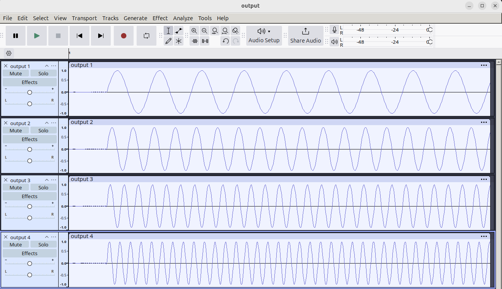

.. _ssrc_example:

SSRC example
============

The ``examples/app_ssrc`` application converts four independent Q1.31 sine
waves, at 1, 2, 3 and 4 kHz, in one four-channel SSRC instance. It generates
approximately 10 ms of input, at 90% full-scale amplitude. The ``sine_generator``
functions in ``examples/shared_utils`` use a quarter-wave lookup table and
exact phase reflection to generate the tones without interpolation. The input and output are
time-interleaved buffers. Each call to ``ssrc_process`` returns the number of
output frames per channel; this can vary from block to block to due to the rational rate conversion.
``AUDIO_DURATION_MS`` in the example sets the capture duration in milliseconds;
it must be between 1 and 100. Longer captures require more memory and simulator
time.

.. uml::
   :caption: SSRC example thread and data flow
   :alt: A single application thread generates the input, converts it with SSRC and writes both input and output WAV files.

   @startuml
   left to right direction
   hide stereotype

   !include thread_diagram_style.puml

   rectangle "Application thread" <<thread>> {
     rectangle "Sine generator" as sine
     rectangle "SSRC" as ssrc
     rectangle "WAV writer" as wav
   }

   sine --> ssrc : input buffer
   ssrc --> wav : output buffer
   sine -[norank]-> wav : input buffer
   @enduml

The input and output rates can each be 44100, 48000, 88200, 96000, 176400 or
192000 Hz. Choose a higher output rate to upsample or a lower one to downsample.
Equal rates are also supported.

SSRC initialization
-------------------

The SSRC state and intermediate stack are allocated per channel, and the
control structures point to them before initialization. The initialization
selects the rates, channel count, input block size and dither setting:

.. literalinclude:: ../../examples/app_ssrc/src/main.c
   :language: c
   :start-at: ssrc_init((fs_code_t)input_code
   :end-at: SSRC_N_CHANNELS, SSRC_N_IN_SAMPLES, OFF);

See :ref:`HiFi quality multi-rate SRC <fig_src_proc>` for the processing and
buffer format details.

Build and simulate
------------------

Activate the appropriate XMOS XTC Tools environment and build from the example
directory, selecting the target for the installed tools:

.. code-block:: console

    cd examples/app_ssrc
    cmake -G "Unix Makefiles" -B build -DAPP_HW_TARGET=XK-EVK-XU316
    xmake -C build
    xsim bin/app_ssrc.xe

Without arguments the example converts 44100 Hz to 96000 Hz. To select a
different pair of rates, use the simulator's ``--args`` option:

.. code-block:: console

    xsim --args bin/app_ssrc.xe 96000 44100

Use target ``XCORE-200-EXPLORER`` for xcore-200, ``XK-EVK-XU316`` for xcore.ai, or
``XK-EVK-XU416`` for xcore-400 with a toolchain supporting that target.
Invalid rates or an incomplete argument pair are reported and
the program exits with an error.

The application terminates after conversion and writes ``input.wav`` and
``output.wav`` in the current working directory using simulator file I/O. Both
are four-channel, 32-bit signed PCM WAV files, with the input and output sample
rates respectively. They are overwritten on the next run. xsim may take around
5 to 20 seconds, depending on the sample rates and host computer. The console reports
the start, completion of sine generation, and completion of conversion and file writing.
After conversion, the example also reports the maximum reference-clock time
for one ``ssrc_process`` call, the input and output sample counts per channel
for that call, and the number of channels.
The shared ``wav_writer`` functions write interleaved
32-bit PCM from memory after the conversion is complete.

Viewing the waveforms
---------------------

Import both WAV files into an audio editor, such as Audacity, and zoom in to see
their four channels on the same timeline. Channels 1 to 4 contain the 1, 2, 3
and 4 kHz tones respectively. The two files have the same time origin; output
waveforms show filter startup and group delay. No filter tail is flushed after
the last input block. Ten milliseconds is intended for waveform inspection,
not listening. The example is an offline demonstration, not a real-time
throughput or however the reported timing is accurate due to xsim being
a cycle accurate simulator.

   SSRC example output waveforms in Audacity.

The group delay can be seen at the start of the output. For a 44100 Hz to
96000 Hz conversion, it was measured as 43 samples.
